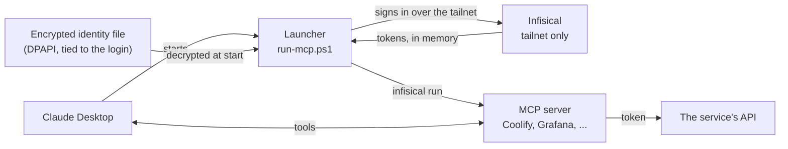

Claude Desktop on Harry's computers talks to his services through MCP servers. Each MCP server needs a token, such as an API token for Coolify or a service account token for Grafana. None of those tokens are stored on the computer. The computer holds one credential that lets it into Infisical, and Infisical holds the rest.

To set up a computer, follow [Give a computer its Claude secrets](../../how-to/give-a-computer-claude-secrets/).

## The flow

1. **One credential sits on the computer.** It's an [Infisical machine identity](https://infisical.com/docs/documentation/platform/identities/machine-identities) that signs in with [Universal Auth](https://infisical.com/docs/documentation/platform/identities/universal-auth): a client ID and a client secret. It can only read one Infisical project, "Claude tools". On Windows it's saved encrypted with [DPAPI](https://learn.microsoft.com/en-us/dotnet/standard/security/how-to-use-data-protection), which ties it to the user's Windows login. The script `set-infisical-cred.ps1` saves it.
2. **A launcher starts each MCP server.** Claude Desktop's [MCP config](https://modelcontextprotocol.io/quickstart/user) doesn't start an MCP server directly. It runs `run-mcp.ps1` with the server's name. The launcher decrypts the credential, signs in to Infisical over the [Tailscale](https://tailscale.com/) tailnet, and starts the server with [`infisical run`](https://infisical.com/docs/cli/commands/run).
3. **Tokens are passed in memory.** `infisical run` gives the server its tokens as environment variables. They're never written to disk, and they're gone when the server stops.
4. **Infisical holds the tokens.** They're secrets in the project's `prod` environment, such as `COOLIFY_ACCESS_TOKEN` and `GRAFANA_SERVICE_ACCOUNT_TOKEN`. To rotate a token, change it in Infisical. Every computer gets the new one the next time Claude Desktop starts.

## Why it's built this way

- **One secret per computer, not one per service.** Adding a service means adding a secret in Infisical, not a file on every computer.
- **Nothing readable on disk.** A plain-text token file gives access to everything it unlocks. The DPAPI file is useless on another computer or in a backup.
- **No password prompt.** DPAPI unlocks with the Windows login, so Claude Desktop starts its servers without asking.
- **One place to rotate.** A token changes in Infisical, and nowhere else.

## How it's locked down

- **Least privilege.** The machine identity can only read the "Claude tools" project. It can't write, and it can't see any other project.
- **Only on the tailnet.** Infisical isn't on the public internet. The identity's trusted IPs are set to Tailscale's range, `100.64.0.0/10`, so a stolen credential doesn't work from outside the tailnet.
- **Infisical's own MCP server is read-only.** Claude can list which secrets exist, but the values are masked.

## What it doesn't protect against

- **Malware running as the user.** DPAPI decrypts for any program running under the same Windows login. Such a program could read the identity, then every secret in "Claude tools". Least privilege and trusted IPs limit what it gets.
- **Computers off the tailnet.** The flow needs Tailscale running. Claude in cloud threads can't use it, because the cloud isn't on the tailnet.
- **The Infisical MCP server's own login.** It can't fetch its credential from Infisical, so it uses the same encrypted identity directly.

## The same pattern on a server

A job on a server can use the same pattern. One example is a sync that copies a token from Infisical into [DevLake](https://devlake.apache.org/), so DevLake always has the current one.

- The machine identity is saved in a file only the job's own user can read, in place of DPAPI.
- The job signs in to Infisical's API, reads the one secret it needs, and passes it on.
- A scheduled job runs it every few minutes, so a token rotated in Infisical reaches the service by itself.
- The identity can only read the project and environment that hold that secret.
